 

 

## 🧠 About me

- 🎓 First-year **Computer Science & Engineering** student
- 🌐 Learning and building with **HTML, CSS and JavaScript**
- 🛠️ Making small projects to turn tutorials into real skills
- 📚 Next up: **Data Structures & Algorithms**
- 🤝 Open to beginner-friendly open source and study partners

 

 

## 🚀 Projects

| Project | What it is | Stack |
|---|---|---|
| 🌐 **Portfolio** | My personal website | HTML · CSS · JS |
| ✅ **To-Do App** | Task manager with local storage | HTML · CSS · JS |
| 🧮 **Calculator** | Clean and simple calculator | HTML · CSS · JS |

> Replace these rows with your real projects and add links.

 

## 🎯 Roadmap

- [x] Start CSE journey
- [x] Learn web basics
- [ ] Build 5 projects
- [ ] Learn DSA
- [ ] First open source contribution
- [ ] Land an internship

 

## 📫 Find me

[**LinkedIn**](https://www.linkedin.com/in/shivansh-tripathi-abbb2242a/)

 

Built with plain SVG and a lot of curiosity.

